<p align="center"></p>
<h3 align="center">Layout Steering for Training-Free World Exploration</h3>

<p align="center">
  <a href="#citation"></a>
  <a href="#"></a>
  <a href="LICENSE"></a>
</p>

<p align="center">
  <b><a href="https://vishu26.github.io/">Srikumar Sastry</a><sup>1,2</sup> ·
  <a href="https://scholar.google.com/citations?user=R14csHAAAAAJ">Meher Gitika Karumuri</a><sup>1</sup> ·
  <a href="https://scholar.google.com/citations?user=u_lYTIwAAAAJ&hl=en">Chenqi Li</a><sup>1,3</sup> ·
  <a href="https://sarosijbose.github.io/">Sarosij Bose</a><sup>1,4</sup> ·
  <a href="https://meilongzhang.github.io/">Mellon Zhang</a><sup>1,5</sup> ·
  <a href="https://tuallen.github.io/">Allen Tu</a><sup>1,6</sup> ·
  <a href="https://sites.google.com/view/yenlianglin">Yen-Liang Lin</a><sup>1</sup> ·
  <a href="https://www.alexander-schwing.de/">Alexander Schwing</a><sup>1,7</sup> ·
  <a href="https://jacobsn.github.io/">Nathan Jacobs</a><sup>2</sup></b>
</p>

<p align="center">
  <sup>1</sup> Amazon &nbsp; <sup>2</sup> Washington University in St. Louis &nbsp; <sup>3</sup> University of Oxford &nbsp; <sup>4</sup> University of California, Riverside<br>
  <sup>5</sup> Georgia Institute of Technology &nbsp; <sup>6</sup> University of Maryland, College Park &nbsp; <sup>7</sup> University of Illinois Urbana-Champaign
</p>

<p align="center">
  &#128640; <b>Training-free</b> &nbsp;·&nbsp; &#128269; <b>One hook, every prior</b> &nbsp;·&nbsp; &#128200; <b>Distance, not only direction</b><br>
  <sub>No weight is changed: a canvas and its reprojected guide steer the first 40&thinsp;% of the denoising steps of Wan&nbsp;2.2, SANA-Video, CogVideoX, SANA-WM and Lyra&nbsp;2.0.</sub>
</p>

<p align="center">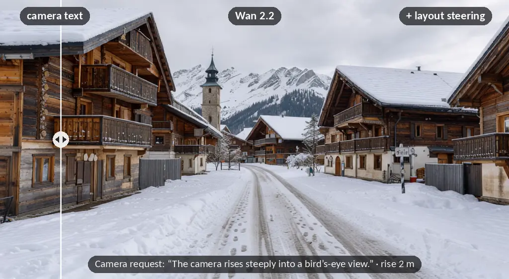</p>

<p align="center"><sub>Wan 2.2, one image, a 2 m rise to a bird’s-eye view. Left of the slider: the camera sentence alone. Right: + layout steering, same seed.</sub></p>

<br>

<br>

## Distance, not only direction

<p align="center">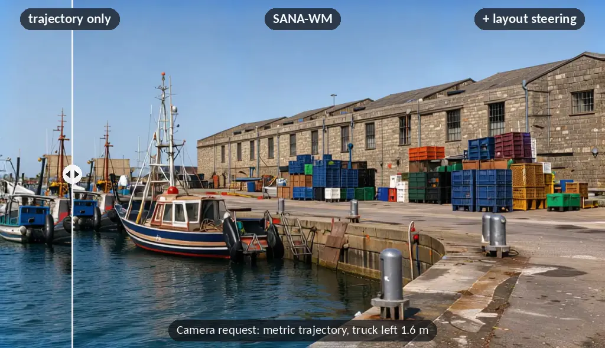</p>

<p align="center"><sub>SANA-WM, a 1.6 m truck left from its metric trajectory. Left: trajectory input alone covers a fraction of it. Right: + layout steering brings the camera the full distance.</sub></p>

<p align="center">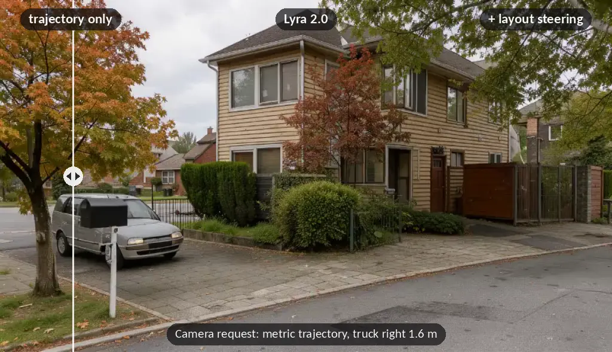</p>

<p align="center"><sub>Lyra 2.0, a 1.6 m truck right from its metric trajectory. The trajectory alone overshoots; + layout steering calibrates the travel to the request.</sub></p>

<br>

## More scenes and moves

<table>
<tr><th></th><th width="140">Truck right, 1.6 m</th><th width="140">Forward, 1.6 m</th><th width="140">Rise, 1.6 m</th><th width="140">Tilt up, 15°</th><th width="140">Orbit right, 12°</th><th width="140">Pan left, 20°</th></tr>
<tr><td><b>Cathedral</b></td><td align="center"></td><td align="center"></td><td align="center"></td><td align="center"></td><td align="center"></td><td align="center">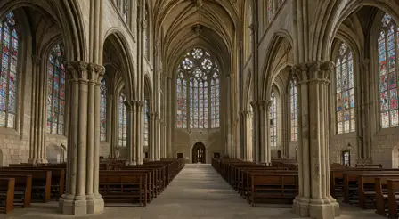</td></tr>
<tr><td><b>Market hall</b></td><td align="center"></td><td align="center"></td><td align="center"></td><td align="center"></td><td align="center"></td><td align="center"></td></tr>
<tr><td><b>Mountain lake</b></td><td align="center"></td><td align="center"></td><td align="center"></td><td align="center"></td><td align="center"></td><td align="center"></td></tr>
<tr><td><b>Riad</b></td><td align="center"></td><td align="center">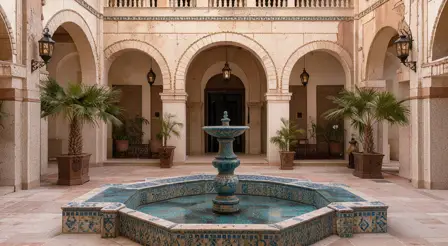</td><td align="center"></td><td align="center">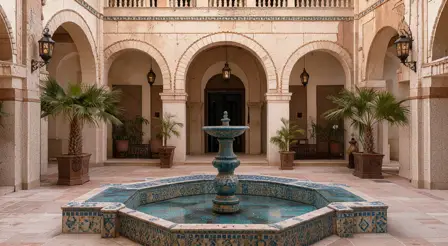</td><td align="center">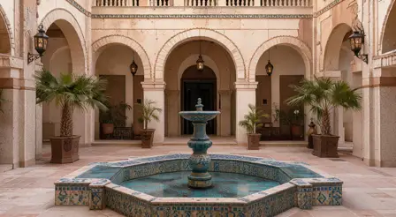</td><td align="center">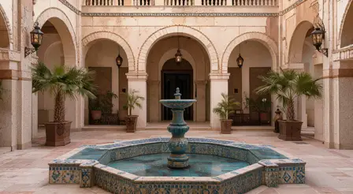</td></tr>
<tr><td><b>Desert road</b></td><td align="center">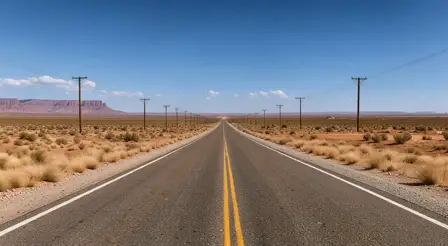</td><td align="center">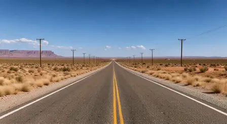</td><td align="center">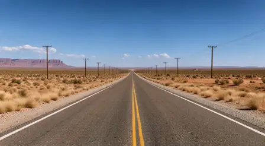</td><td align="center">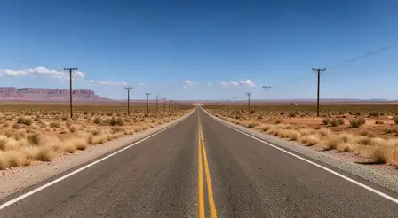</td><td align="center">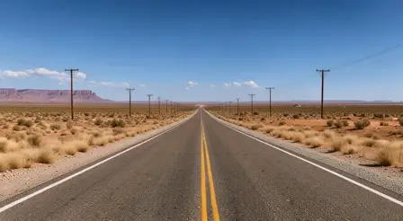</td><td align="center">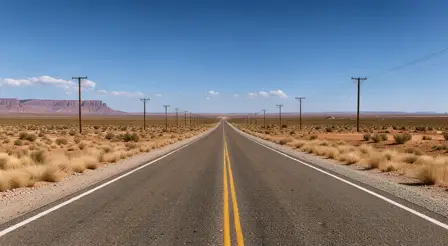</td></tr>
<tr><td><b>Rooftop</b></td><td align="center"></td><td align="center"></td><td align="center"></td><td align="center">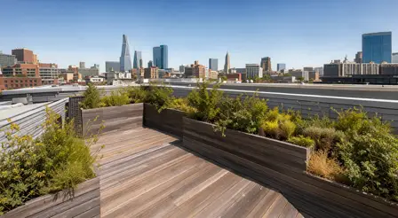</td><td align="center"></td><td align="center">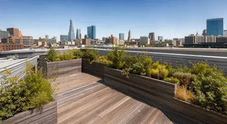</td></tr>
</table>

<br>

## Benchmark scenes

The benchmark cells highlighted in the paper. Each pair compares the model's own camera control with layout steering added (blue frame).

**Wan 2.2 TI2V-5B**

<table>
<tr><th width="170"></th><th width="220">Forward<br><sub>Sewing machine</sub></th><th width="220">Tilt up<br><sub>Pandas</sub></th><th width="220">Truck right<br><sub>Corgi drummer</sub></th><th width="220">Zoom out<br><sub>Sea turtle</sub></th></tr>
<tr><td align="center"></td><td align="center">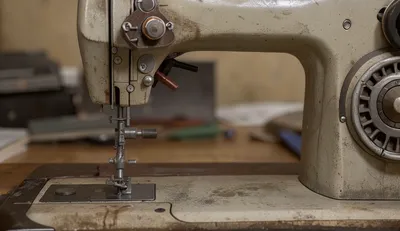</td><td align="center"></td><td align="center">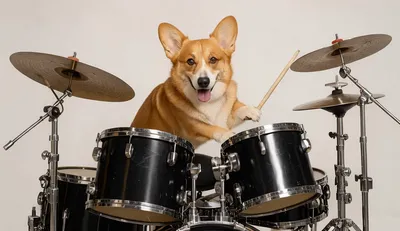</td><td align="center">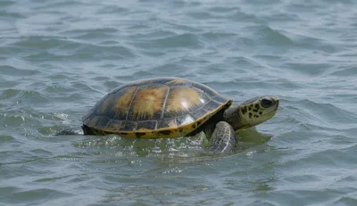</td></tr>
<tr><td align="center"><br></td><td align="center">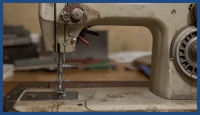</td><td align="center"></td><td align="center">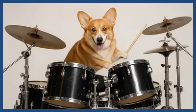</td><td align="center">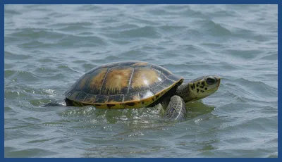</td></tr>
</table>

**SANA-WM**

<table>
<tr><th width="170"></th><th width="220">Forward<br><sub>Sewing machine</sub></th><th width="220">Tilt up<br><sub>Pandas</sub></th><th width="220">Truck right<br><sub>Corgi drummer</sub></th><th width="220">Zoom out<br><sub>Sea turtle</sub></th></tr>
<tr><td align="center"></td><td align="center">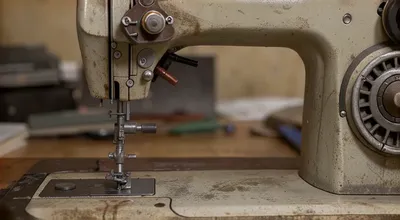</td><td align="center"></td><td align="center"></td><td align="center">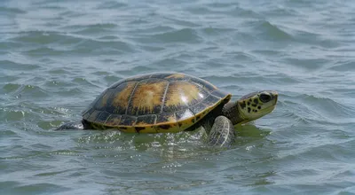</td></tr>
<tr><td align="center"><br></td><td align="center">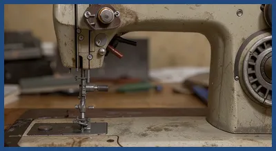</td><td align="center"></td><td align="center">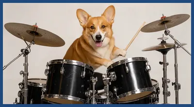</td><td align="center">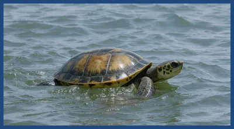</td></tr>
</table>

**Lyra 2.0**

<table>
<tr><th width="170"></th><th width="220">Forward<br><sub>Sewing machine</sub></th><th width="220">Tilt up<br><sub>Pandas</sub></th><th width="220">Truck right<br><sub>Corgi drummer</sub></th><th width="220">Zoom out<br><sub>Sea turtle</sub></th></tr>
<tr><td align="center"></td><td align="center">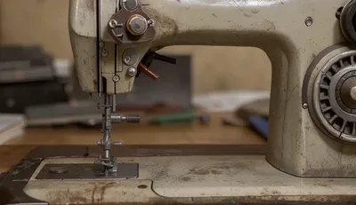</td><td align="center"></td><td align="center"></td><td align="center">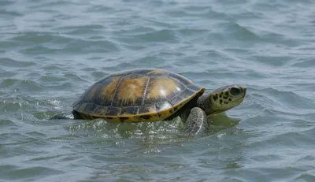</td></tr>
<tr><td align="center"><br></td><td align="center"></td><td align="center"></td><td align="center"></td><td align="center">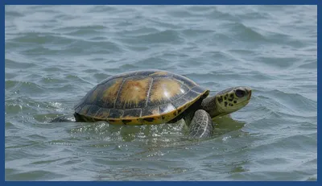</td></tr>
</table>

<br>

## One hook, three priors

**Harbour**

<table>
<tr><th></th><th>Bird's-eye, rise 2 m</th><th>Orbit left 12°</th><th>Pan right 20°</th></tr>
<tr><td><b>Wan 2.2</b></td><td>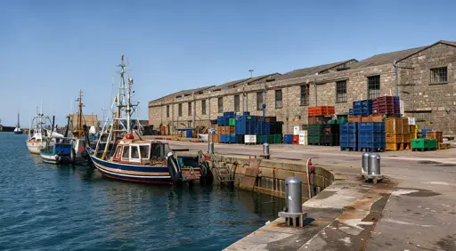</td><td>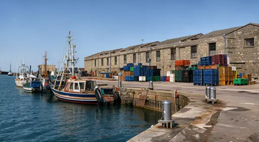</td><td>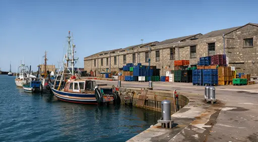</td></tr>
<tr><td><b>SANA-Video 2.0</b></td><td></td><td>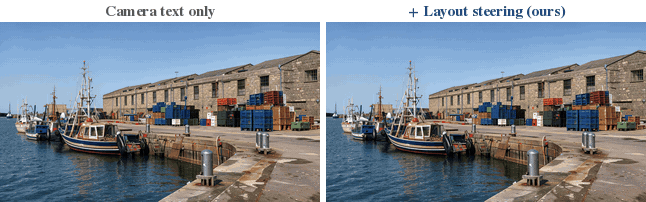</td><td></td></tr>
<tr><td><b>CogVideoX 1.5</b></td><td>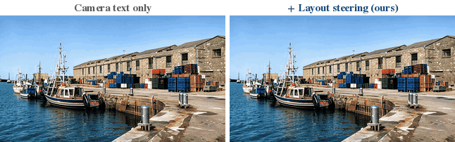</td><td></td><td>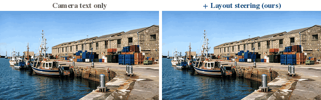</td></tr>
</table>

**Alley**

<table>
<tr><th></th><th>Bird's-eye, rise 2 m</th><th>Orbit left 12°</th><th>Pan right 20°</th></tr>
<tr><td><b>Wan 2.2</b></td><td>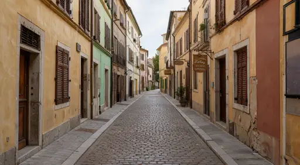</td><td></td><td>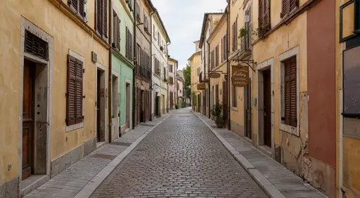</td></tr>
<tr><td><b>SANA-Video 2.0</b></td><td>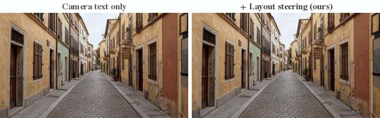</td><td></td><td>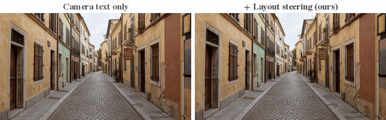</td></tr>
<tr><td><b>CogVideoX 1.5</b></td><td>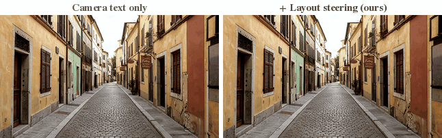</td><td>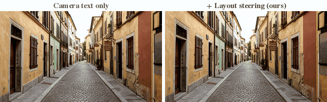</td><td>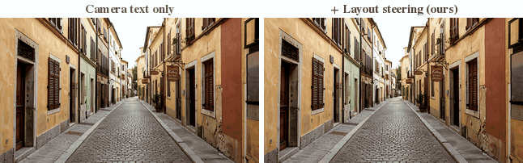</td></tr>
</table>

**Alpine village**

<table>
<tr><th></th><th>Bird's-eye, rise 2 m</th><th>Orbit left 12°</th><th>Pan right 20°</th></tr>
<tr><td><b>Wan 2.2</b></td><td></td><td>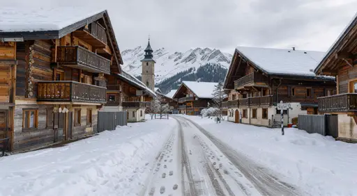</td><td></td></tr>
<tr><td><b>SANA-Video 2.0</b></td><td>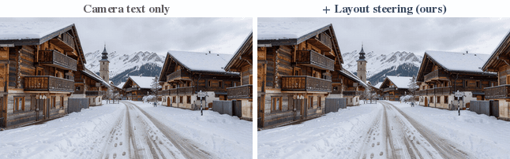</td><td>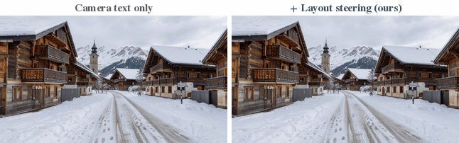</td><td></td></tr>
<tr><td><b>CogVideoX 1.5</b></td><td>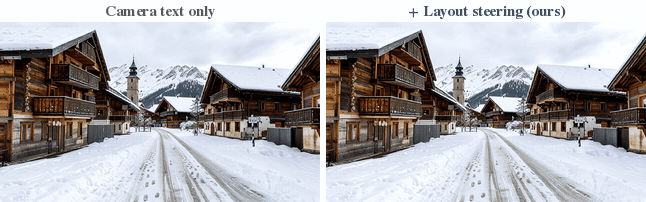</td><td>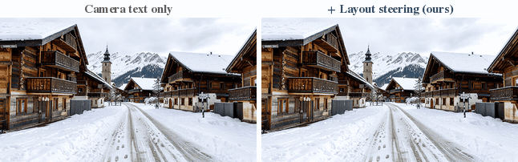</td><td>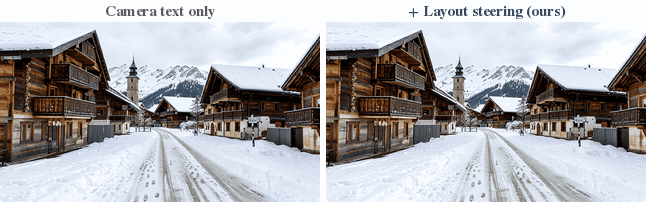</td></tr>
</table>

<br>

## Quick start

```bash
pip install -e . && pip install diffusers transformers accelerate

# 1. the canvas: FLUX.1 Fill outpaints what the camera will reveal (the input image stays exact)
python scripts/make_canvas_outpaint.py --image examples/f19.png --prompt "<caption>" --whole --out canvases/f19

# 2. steer the prior along any move (the guide is rendered inside)
python scripts/video_between.py --frames 81 --backend i2v --size 1280 --guide none --no-paste-anchors \
  --image canvases/f19/photo.png --frame-prompt "<caption> The camera orbits to the left around the scene." \
  --move orbit_left --amount 15 --guide3d pi3x --guide3d-canvas canvases/f19/canvas.png --guide3d-offset 512 288 \
  --layout pan --layout-steps 20 --layout-sigma 3 --layout-weight 1.0 --nominal 4 --out runs/f19_orbit_left
```

Other priors: render the guide once with `scripts/guide_video.py`, then `scripts/cog_layout.py` (CogVideoX) or `sana/patch_*.py` (SANA). Moves: trucks, rise, descend, forward, back (metres); pan, tilt, roll, orbits, bird's-eye (degrees).

## Settings

A plain Pi3X-depth guide re-projected from a FLUX.1 Fill canvas steers early denoising with a decaying low-frequency
correction (sigma 3 latent cells, stretch-confidence weighted). Unless noted, the weight decays linearly to zero. Wan, CogVideoX,
HunyuanVideo and Cosmos use a mean-neutral correction; the SANA models keep the full correction, whose DC-AE latent stores
layout in the channel means. Pans and orbits are capped at the canvas margin. Per-model settings, as in the paper:

| Prior | Steered steps *K* | Weight | sigma | Correction |
|:--|:--:|:--:|:--:|:--|
| Wan 2.2 TI2V-5B | first 40 % (20 of 50) | 1.0 | 3 | mean-neutral |
| SANA-WM | 30 of 60 | 1.5 | 3 | raw |
| Lyra 2.0 | first 40 % (14 of 35) | 1.0 | 3 | raw |
| SANA-Video 2.0 5B | 40 of 50 | 1.0 | 3 | raw |
| CogVideoX-Fun 5B | 15 of 50 | 1.0 | 3 | mean-neutral |
| Wan 2.1 / HunyuanVideo 1.5 | 15 of 50 | 1.0 | 3 | mean-neutral |
| Cosmos-Predict1 7B | 11 of 36 | 1.0 | 3 | mean-neutral |

## Citation

```bibtex
@misc{dreamtour2026,
  title  = {DreamTour: Layout Steering for Training-Free World Exploration},
  author = {Sastry, Srikumar and Karumuri, Meher Gitika and Li, Chenqi and Bose, Sarosij and Zhang, Mellon and Tu, Allen and Lin, Yen-Liang and Schwing, Alexander and Jacobs, Nathan},
  year   = {2026},
  note  = {https://github.com/dreamtourls/DreamTour}
}
```

Apache 2.0 license; model weights keep their own licenses.
